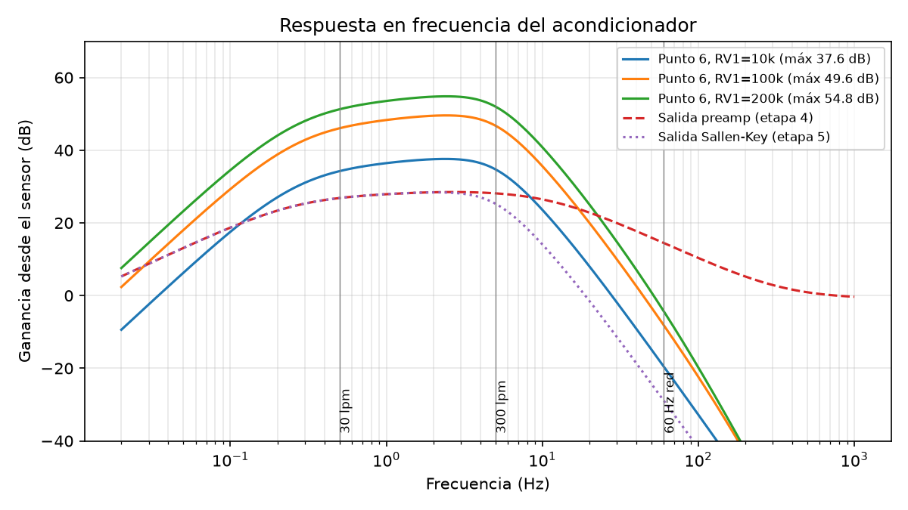
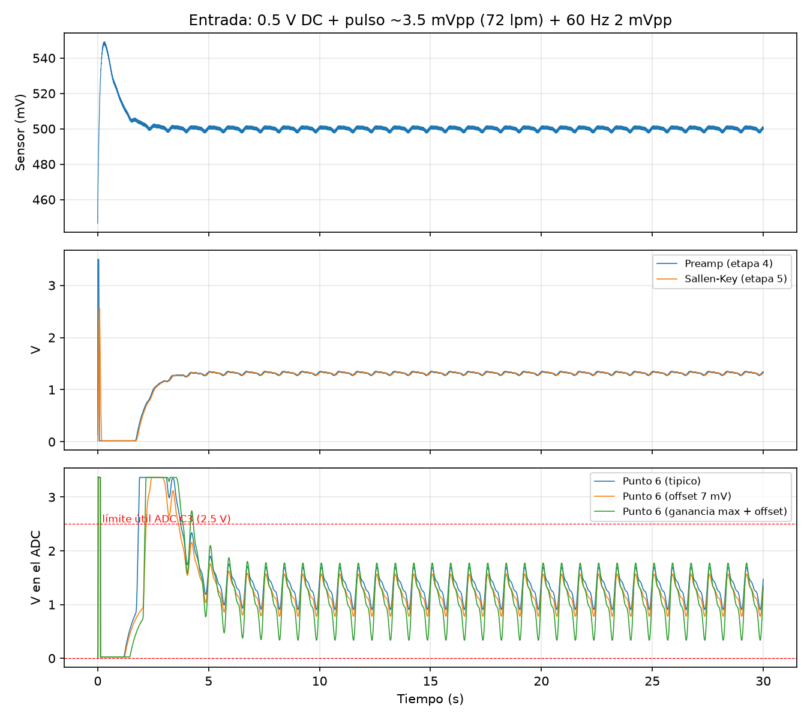
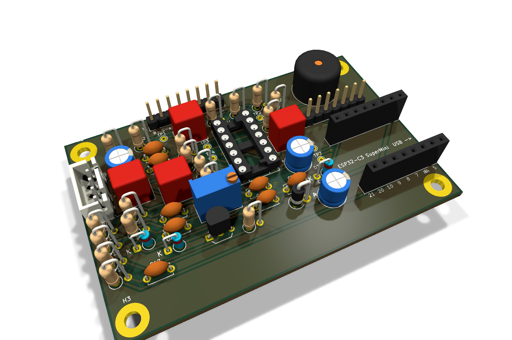
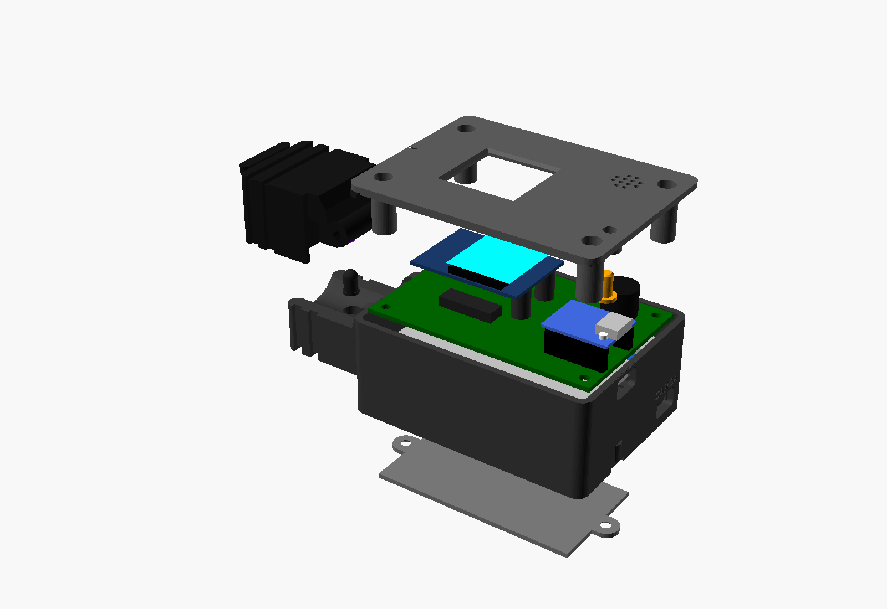

# Resumen

Se diseñó e implementó un prototipo de medidor de ritmo cardiaco por fotopletismografía (PPG) en modo de transmisión. Un LED infrarrojo y un fotodiodo enfrentados en una pinza de dedo detectan la variación del volumen de sangre. Un LM324 acondiciona la señal en seis etapas: sensor, acople AC, seguidor, preamplificador, filtro pasabajas Sallen-Key y amplificación final. La señal del Punto 6 queda centrada en 1.32 V, dentro del rango del ADC del ESP32-C3.

El microcontrolador detecta los latidos, calcula los BPM y muestra la onda en una OLED de 0.96". Publica los datos por MQTT a un servidor Mosquitto + Node-RED. El servidor dibuja las gráficas y envía alertas tempranas por correo y WhatsApp.

En simulación, la banda de paso del acondicionador va de 0.46 a 5.05 Hz (28 a 303 lpm). La ganancia es ajustable entre 83 y 600 V/V, y el ruido de 60 Hz queda 58 dB por debajo del pulso.

# Objetivos

**General.** Diseñar e implementar un prototipo de medidor de ritmo cardiaco basado en PPG con filtros activos y conectividad IoT para el monitoreo y las alertas en tiempo real.

**Específicos.**

1. Acondicionar la señal del fotodiodo con un LM324 en etapas validables por separado.
2. Diseñar un filtro activo Sallen-Key de segundo orden con corte cercano a 5 Hz (300 lpm).
3. Garantizar que la señal del Punto 6 permanezca entre 0 y 3.3 V (requisito de la guía).
4. Calcular los BPM en el ESP32 y mostrarlos con la forma de onda en una OLED I2C.
5. Transmitir los datos por MQTT y generar alertas tempranas por correo y WhatsApp.
6. Construir un prototipo con PCB y carcasa impresa en 3D.

# Diagrama de bloques

```
 Pinza          Acondicionamiento analógico (LM324, 5 V, referencia 1.32 V)                 ESP32-C3
┌───────┐   ┌──────┐  ┌──────┐  ┌────────┐  ┌────────────┐  ┌──────┐  ┌────────┐  ┌──────┐  ┌───────────┐
│LED IR │──▶│ 1    │─▶│ 2    │─▶│ 3      │─▶│ 4 Preamp   │─▶│ 5 SK │─▶│ 6 Final│─▶│Prot. │─▶│ADC GPIO1  │
│Fotod. │   │Sensor│  │Acople│  │Seguidor│  │ ×34        │  │4.9 Hz│  │ ×2…22  │  │4.7k+ │  │DSP, BPM   │
└───────┘   └──────┘  └──────┘  └────────┘  └────────────┘  └──────┘  └────────┘  │BAT85 │  │OLED, buzz.│
                       0.31 Hz                 fLP 10 Hz               (+acople    └──────┘  │MQTT WiFi  │
                                                                        0.34 Hz)    Punto 6  └─────┬─────┘
                                                                                                   │ MQTT
                                          Correo / WhatsApp ◀── Node-RED (alertas, tablero) ◀── Mosquitto
```

# Diseño del acondicionamiento analógico

Todo el circuito usa una sola fuente de 5 V. Para no recortar la señal en 0 V, las etapas trabajan alrededor de una **referencia de 1.32 V** (mitad del rango útil del ADC del ESP32-C3, que es de 0 a 2.5 V con atenuación de 12 dB).

## Mejoras frente al diseño de referencia del curso

| Problema del diseño base | Efecto | Solución |
|---|---|---|
| Señal centrada en 0 V | Medio ciclo negativo entra al ADC | Referencias de 1.32 V |
| Pasaaltas de 1.6 Hz (1 µF, 100 kΩ) | Atenúa pulsos < 95 lpm | 1 µF + 470 kΩ → 0.31 Hz |
| Ganancia DC de 617 | El offset del LM324 (hasta 7 mV) satura la salida | Ganancia DC unitaria por acoples AC |
| Zener de 3.3 V como protección | Fuga apreciable desde ~2.5 V | 4.7 kΩ + dos Schottky BAT85 a 3.3 V y GND |
| Una sola referencia compartida | La corriente del Rg final vuelve a la entrada (−4 dB en banda) | VREF1 y VREF2 independientes |

## Etapa 1 — Sensor óptico

LED IR con $R_1 = 220\ \Omega$ desde 5 V:

$$I_{LED} = \frac{5 - 1.25}{220} \approx 17\ \text{mA}$$

El fotodiodo trabaja en inversa (cátodo a 5 V). Su fotocorriente produce una tensión sobre $R_2 = 47\ \text{k}\Omega$. Con algunos µA de corriente, el nivel DC queda entre 0.1 y 1 V, y el pulso entre 0.5 y 5 mV.

## Etapa 2 — Acople AC y referencias

$$f_{HP} = \frac{1}{2\pi (R_2 + R_3) C_1} = \frac{1}{2\pi (47\text{k} + 470\text{k})(1\ \mu\text{F})} = 0.31\ \text{Hz}$$

$$V_{REF} = 3.3 \cdot \frac{1\ \text{k}}{1.5\ \text{k} + 1\ \text{k}} = 1.32\ \text{V}$$

Cada referencia se desacopla con 100 µF ∥ 100 nF.

## Etapa 3 — Seguidor (U1A)

Ganancia unitaria. Aísla el pasaaltas de la carga del preamplificador. Su impedancia de entrada es alta y la de salida baja.

## Etapa 4 — Preamplificador no inversor (U1B)

$$A_{pre} = 1 + \frac{R_5}{R_4} = 1 + \frac{330\ \text{k}}{10\ \text{k}} = 34\ \text{V/V}\ (30.6\ \text{dB})$$

$$f_{LP} = \frac{1}{2\pi R_5 C_5} = \frac{1}{2\pi (330\ \text{k})(47\ \text{nF})} = 10.3\ \text{Hz}$$

$R_4$ va a VREF1, así que la salida en DC es $V_{REF1} + 34\,V_{os}$. El acople AC siguiente elimina ese offset.

## Etapa 5 — Filtro pasabajas Sallen-Key de ganancia unitaria (U1C)

Con $R_6 = R_7 = R = 47\ \text{k}\Omega$, $C_3 = 1\ \mu\text{F}$ (realimentación) y $C_2 = 470\ \text{nF}$ (a tierra):

$$f_0 = \frac{1}{2\pi R \sqrt{C_3 C_2}} = \frac{1}{2\pi (47\ \text{k})\sqrt{(1\ \mu)(470\ \text{n})}} = 4.94\ \text{Hz}$$

$$Q = \frac{1}{2}\sqrt{\frac{C_3}{C_2}} = \frac{1}{2}\sqrt{\frac{1}{0.47}} = 0.73$$

$Q \approx 0.707$ corresponde a una respuesta Butterworth: plana en la banda y sin sobrepico. Un corte de 5 Hz cubre la frecuencia cardiaca máxima indicada en la guía (300 lpm).

## Acople 2 y Etapa 6 — Amplificación final (U1D)

$C_8 = 1\ \mu\text{F}$ y $R_{11} = 470\ \text{k}\Omega$ a VREF2 ($f = 0.34$ Hz) eliminan el offset del preamplificador.

$$A_{fin} = 1 + \frac{R_9 + R_{V1}}{R_8} = 1 + \frac{10\ \text{k} + (0 \ldots 200\ \text{k})}{10\ \text{k}} = 2 \ldots 22\ \text{V/V}$$

El trimmer $R_{V1}$ permite ajustar la amplitud según el dedo y el sensor. $C_9 = 10$ nF limita el ruido de alta frecuencia.

## Protección del ADC (Punto 6)

$R_{10} = 4.7\ \text{k}\Omega$ en serie, $C_7 = 100$ nF a tierra ($f_c = 340$ Hz, antialias) y dos BAT85 al riel de 3.3 V y a GND. En el peor caso de arranque, el pin queda por debajo de 3.6 V, el máximo absoluto del ESP32-C3.

## Ganancia total

$$A_{total} = A_{pre} \cdot A_{fin} = 34 \times (2 \ldots 22) = 68 \ldots 748\ \text{V/V}$$

En el diseño del curso se usó 617 V/V. Aquí la ganancia es ajustable y la ganancia en DC es 1.

# Simulación (ngspice)

Modelo macro del LM324: GBW de 1 MHz y salida de 0.02 V a $V_{CC} - 1.5$ V. Archivos: `01_analogico/ppg.cir` y `simular.py`.



| RV1 | Ganancia máxima | f −3 dB baja | f −3 dB alta |
|---|---|---|---|
| 10 kΩ | 38.4 dB (83 V/V) | 0.46 Hz | 4.99 Hz |
| 100 kΩ | 50.3 dB (328 V/V) | 0.46 Hz | 5.05 Hz |
| 200 kΩ | 55.6 dB (600 V/V) | 0.46 Hz | 5.05 Hz |

A 60 Hz, la ganancia queda 58 dB por debajo de la del pulso (1.2 Hz).



| Caso | Mín (V) | Máx (V) | Vpp | Media |
|---|---|---|---|---|
| Típico (RV1 = 100k) | 0.849 | 1.724 | 0.875 | 1.320 |
| Offset 7 mV en cada op-amp | 0.724 | 1.599 | 0.875 | 1.195 |
| Ganancia máxima + offset 7 mV | 0.230 | 1.831 | 1.602 | 1.091 |

En todos los casos el Punto 6 queda entre 0 y 2.5 V. La señal se asienta en unos 5 s tras encender.

# Circuito impreso

PCB de 80 × 52 mm, dos capas, componentes THT y plano de tierra en ambas caras. El ruteo se hizo con Freerouting. La revisión DRC de KiCad dio 0 errores, 0 conexiones pendientes y coincidencia total entre esquema y placa. Incluye siete puntos de prueba (TP1 a TP7) para validar cada etapa con el osciloscopio, como pide la guía.



El esquema completo está en `02_pcb/fab/medidor_ppg_esquema.pdf` (Anexo A).

## Alimentación

LiPo 3.7 V → TP4056 USB-C (carga y protección) → interruptor → MT3608 (5.0 V) → 1N5819 → riel de 5 V. El SuperMini genera los 3.3 V con su regulador. El consumo es de unos 150 mA con WiFi, lo que da unas 6 a 7 horas con 1000 mAh. Un divisor 100k/100k en GPIO0 mide la batería.

# Firmware

PlatformIO con el framework Arduino sobre el ESP32-C3. Código en `03_firmware/`.

| Bloque | Implementación |
|---|---|
| Muestreo | 200 Hz en una tarea FreeRTOS con período fijo; cada muestra promedia 8 lecturas `analogReadMilliVolts` |
| Filtrado digital | Remoción de DC (promedio exponencial) + pasabajas |
| Detección de latidos | Umbral adaptativo con histéresis; período refractario de 200 ms (300 lpm) |
| BPM | Mediana de los últimos 5 intervalos; válido de 30 a 220 lpm |
| Dedo ausente | Amplitud o nivel DC fuera de rango |
| OLED | Onda en desplazamiento, BPM grande, corazón que late, iconos de WiFi, MQTT y batería |
| Buzzer | Pitido de 30 ms por latido; BOOT largo = silencio |
| MQTT | Reconexión sin bloquear, LWT `online`, configuración retenida guardada en NVS |

El código de procesamiento se probó en el PC con 13 pruebas unitarias. Se usaron señales sintéticas de 40 a 200 lpm, con ruido fuerte y retiro del dedo; las 13 pasan. El entorno `c3_demo` genera una señal PPG interna para probar la pantalla y el MQTT sin la tarjeta analógica.

# Comunicación IoT y alertas

## Protocolo

MQTT 3.1.1 sobre TCP 1883, con broker Mosquitto (usuario y contraseña, ACL por tópico). Tópicos bajo `pulso/<id>/`:

| Tópico | Frecuencia | Contenido |
|---|---|---|
| `estado` | 1 Hz | BPM, dedo, señal válida, batería (V y %), RSSI |
| `onda` | 4 Hz | 25 muestras a 50 Hz (mV) |
| `latido` | por latido | intervalo RR y BPM |
| `alerta` | evento | tipo, BPM, umbral |
| `config` | retenido | BPM mínimo y máximo, buzzer |
| `online` | LWT retenido | 1 / 0 |

## Motor de alertas tempranas (Node-RED)

| Alerta | Regla | Espera |
|---|---|---|
| Pulso alto / bajo | Fuera de [mín, máx] por 10 s | 5 min |
| Subida / bajada rápida | Cambio > 25 lpm en 30 s | 5 min |
| Sin señal | 60 s sin señal en plena medición | 5 min |
| Desconectado | 60 s sin datos o LWT | 5 min |
| Batería baja | < 3.4 V | 30 min |

Las reglas de "subida/bajada rápida" avisan **antes** de que el pulso cruce el umbral fijo. El envío se hace por **correo** (SMTP de Gmail) y por **WhatsApp** (API de CallMeBot). Cada lectura y cada alerta se guardan en archivos CSV.

## Tablero

Dashboard 2.0 de Node-RED con BPM en vivo, indicador por zonas, onda PPG (6 s), historial de 30 min, estado del equipo, registro de alertas y formulario de umbrales.

[Captura del tablero con el equipo real]

## Pruebas del servidor

Con el simulador (`04_iot/simulador.py`) se verificaron los escenarios de taquicardia (72 → 140 lpm), bradicardia (72 → 45 lpm), desconexión y batería baja. Se dispararon las alertas `subida_rapida`, `alto`, `desconectado`, `bajada_rapida`, `bajo` y `bateria_baja`, y se registraron en CSV.

# Carcasa

Diseño paramétrico en OpenSCAD, impreso sin soportes. La pinza tiene bisagra M3 y liga. El LED y el fotodiodo van enfrentados dentro de tubos de sombra y la mandíbula es negra para bloquear la luz ambiente. La tapa lleva la ventana de la OLED, la rejilla del buzzer y el botón BOOT. La pared trasera tiene dos USB-C rotulados: "PROG" para programar y "CARGA" para la batería.



# Resultados experimentales

[Completar con las medidas reales]

| Punto | Medida esperada | Medida real |
|---|---|---|
| TP1 sensor | DC 0.1–1 V | |
| TP2 seguidor | ≈1.32 V + pulso | |
| TP3 preamp | pulso ≈0.1 Vpp | |
| TP4 Sallen-Key | igual, más suave | |
| TP5 Punto 6 | 0.8–1.6 Vpp, centrado en 1.32 V | |
| BPM OLED vs. oxímetro comercial | ± 3 lpm | |

[Capturas del osciloscopio por etapa — Figura 3 de la guía]

[Foto del prototipo terminado]

# Conclusiones

1. Centrar todas las etapas en una referencia de 1.32 V permite usar una sola fuente y mantener el Punto 6 dentro del rango del ADC sin señales negativas.
2. Los acoples AC entre etapas dan ganancia DC unitaria. Así el offset del LM324 no satura la salida, como sí ocurre con una ganancia DC de 600.
3. Separar las referencias VREF1 y VREF2 eliminó una realimentación parásita. Sin esa separación, la banda del pulso perdía 4 dB.
4. El Sallen-Key con $Q = 0.73$ da una respuesta casi Butterworth con corte en 4.94 Hz. Junto con los otros polos, el ruido de 60 Hz queda 58 dB por debajo del pulso.
5. La mediana de los intervalos y el período refractario hacen que el BPM sea estable frente a picos falsos.
6. MQTT con LWT y mensajes retenidos permite detectar la desconexión del equipo y sincronizar los umbrales en ambos sentidos.

# Referencias

1. Guía FGL 029 "Proyecto final", ITM, 2025.
2. Texas Instruments, *LM324 Quadruple Operational Amplifier*, hoja de datos.
3. Espressif, *ESP32-C3 Technical Reference Manual* (ADC, atenuación 12 dB).
4. Texas Instruments, *Analysis of the Sallen-Key Architecture*, SLOA024.
5. J. Allen, "Photoplethysmography and its application in clinical physiological measurement", *Physiol. Meas.*, 2007.
6. OASIS, *MQTT Version 3.1.1*, 2014.

# Anexos

- A. Esquema: `02_pcb/fab/medidor_ppg_esquema.pdf`
- B. Lista de materiales: `02_pcb/fab/medidor_ppg_BOM.csv` y `README.md` (lista de compras)
- C. Código: `03_firmware/`, `04_iot/`
- D. Netlist de simulación: `01_analogico/ppg.cir`
