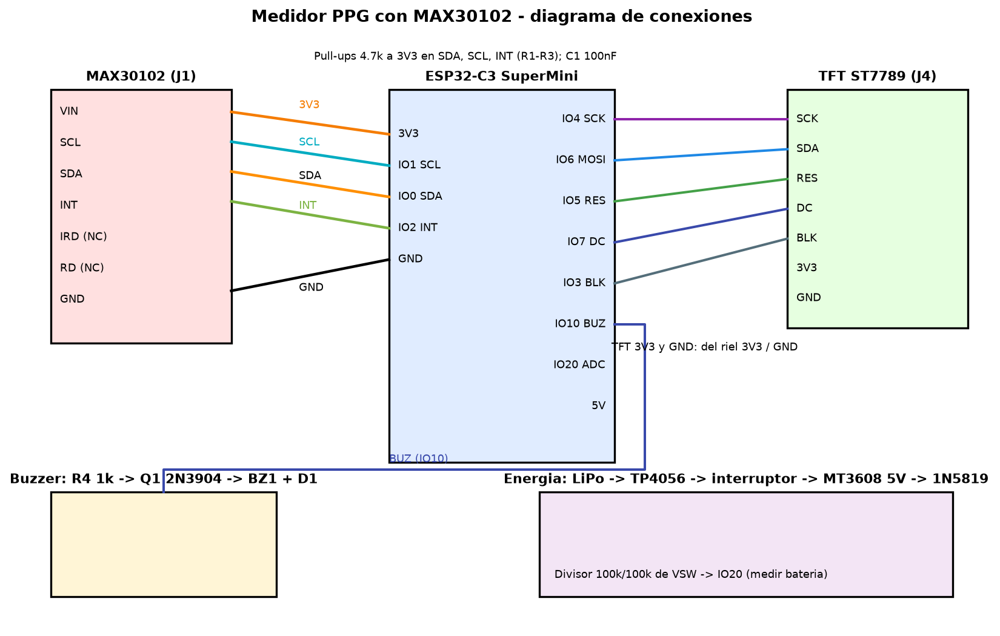
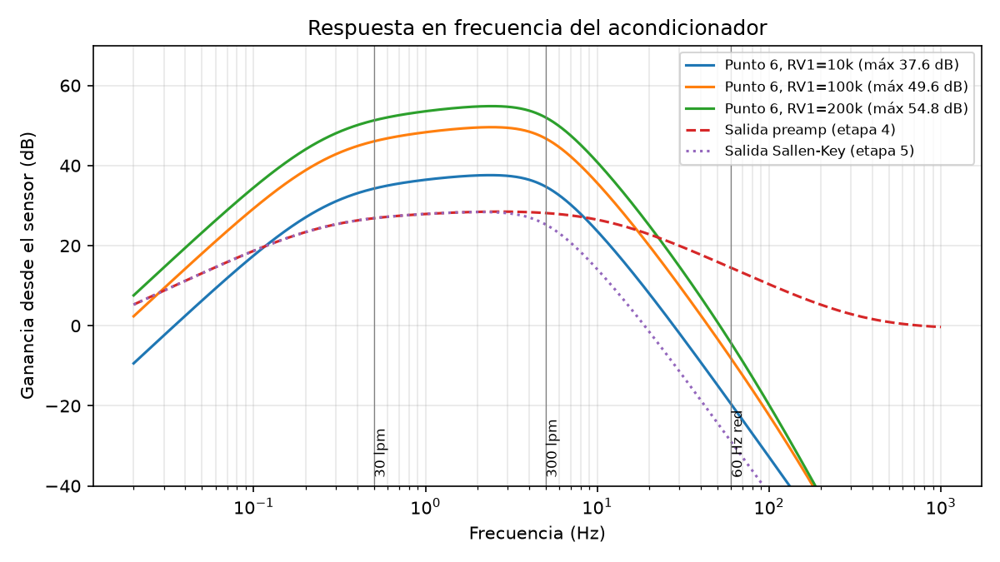
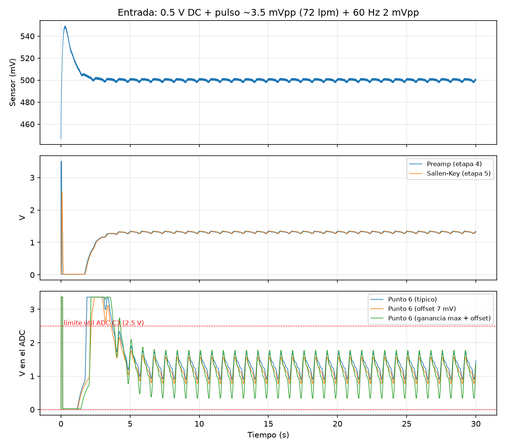
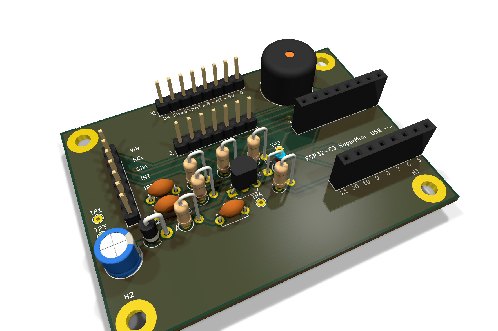
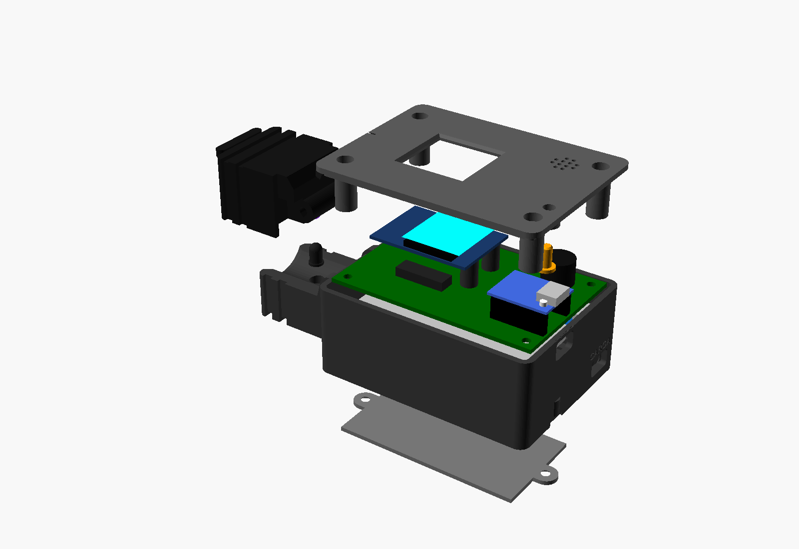

# Resumen

Se diseñó e implementó un prototipo de medidor de ritmo cardiaco por fotopletismografía (PPG) en modo de transmisión. Un LED infrarrojo y un fotodiodo enfrentados en una pinza de dedo detectan la variación del volumen de sangre. Un LM324 acondiciona la señal en seis etapas: sensor, acople AC, seguidor, preamplificador, filtro pasabajas Sallen-Key y amplificación final. La señal del Punto 6 queda centrada en 1.32 V, dentro del rango del ADC del ESP32-C3.

El microcontrolador detecta los latidos, calcula los BPM y muestra la onda en una OLED de 0.96". Publica los datos por MQTT a un servidor Mosquitto + Node-RED. El servidor dibuja las gráficas y envía alertas tempranas por correo y WhatsApp.

En simulación, la banda de paso del acondicionador va de 0.46 a 5.05 Hz (28 a 303 lpm). La ganancia es ajustable entre 83 y 600 V/V, y el ruido de 60 Hz queda 58 dB por debajo del pulso.

# Objetivos

**General.** Diseñar e implementar un prototipo de medidor de ritmo cardiaco basado en PPG con filtros activos y conectividad IoT para el monitoreo y las alertas en tiempo real.

**Específicos.**

1. Acondicionar la señal del fotodiodo con un LM324 en etapas validables por separado.
2. Diseñar un filtro activo Sallen-Key de segundo orden con corte cercano a 5 Hz (300 lpm).
3. Garantizar que la señal del Punto 6 permanezca entre 0 y 3.3 V (requisito de la guía).
4. Calcular los BPM en el ESP32 y mostrarlos con la forma de onda en una OLED I2C.
5. Transmitir los datos por MQTT y generar alertas tempranas por correo y WhatsApp.
6. Construir un prototipo con PCB y carcasa impresa en 3D.

# Diagrama de bloques

```
 Pinza          Acondicionamiento analógico (LM324, 5 V, referencia 1.32 V)                 ESP32-C3
┌───────┐   ┌──────┐  ┌──────┐  ┌────────┐  ┌────────────┐  ┌──────┐  ┌────────┐  ┌──────┐  ┌───────────┐
│LED IR │──▶│ 1    │─▶│ 2    │─▶│ 3      │─▶│ 4 Preamp   │─▶│ 5 SK │─▶│ 6 Final│─▶│Prot. │─▶│ADC GPIO1  │
│Fotod. │   │Sensor│  │Acople│  │Seguidor│  │ ×34        │  │4.9 Hz│  │ ×2…22  │  │4.7k+ │  │DSP, BPM   │
└───────┘   └──────┘  └──────┘  └────────┘  └────────────┘  └──────┘  └────────┘  │BAT85 │  │OLED, buzz.│
                       0.31 Hz                 fLP 10 Hz               (+acople    └──────┘  │MQTT WiFi  │
                                                                        0.34 Hz)    Punto 6  └─────┬─────┘
                                                                                                   │ MQTT
                                          Correo / WhatsApp ◀── Node-RED (alertas, tablero) ◀── Mosquitto
```

# Diseño del acondicionamiento analógico

Todo el circuito usa una sola fuente de 5 V. Para no recortar la señal en 0 V, las etapas trabajan alrededor de una **referencia de 1.32 V** (dentro del rango útil del ADC del ESP32-C3, de 0 a 2.5 V con atenuación de 12 dB). Todos los valores de esta sección corresponden al netlist de simulación `01_analogico/ppg.cir`, que es la fuente de verdad del circuito.

## El problema de medición

La señal que entrega el sensor óptico tiene tres partes superpuestas, y el trabajo del acondicionador es separarlas:

| Componente de la señal | Frecuencia | Qué hacemos con él |
|---|---|---|
| Nivel DC de la luz (dedo + LED fijo) | 0 Hz | **Eliminar** (acople AC) |
| Pulso cardiaco (lo que queremos) | 0.5 – 5 Hz | **Dejar pasar y amplificar** |
| Ruido de la red eléctrica | 60 Hz | **Bloquear** (filtro pasabajas) |
| Ruido térmico / radiofrecuencia | > 100 Hz | **Bloquear** |

De ahí salen las tres decisiones de diseño: un **pasaaltas** muy bajo (para quitar el DC sin tocar el pulso lento), un **pasabajas** en ~5 Hz (para matar los 60 Hz), y **dos etapas de ganancia** (porque el pulso entra en milivoltios y el ADC necesita cientos de milivoltios). La banda de paso resultante es un **pasabanda de 0.3 a 5 Hz**.

## Mejoras frente al diseño de referencia del curso

| Problema del diseño base | Efecto | Solución |
|---|---|---|
| Señal centrada en 0 V | Medio ciclo negativo entra al ADC y se pierde | Referencias de 1.32 V |
| Pasaaltas de 1.6 Hz (1 µF, 100 kΩ) | Atenúa pulsos lentos (< 95 lpm) | 1 µF + 470 kΩ → 0.31 Hz |
| Ganancia DC de 617 | El offset del LM324 (hasta 7 mV) × 617 satura la salida | Ganancia DC unitaria por acoples AC |
| Zener de 3.3 V como protección | Fuga apreciable desde ~2.5 V, deforma la señal | 4.7 kΩ + dos Schottky BAT85 a 3.3 V y GND |
| Una sola referencia compartida | La corriente del Rg final vuelve a la entrada (−4 dB en banda) | VREF1 y VREF2 independientes |

---

## Etapa 1 — Sensor óptico (fotopletismografía por transmisión)

```
      +5V
       │
      ┌┴┐ R1 220Ω
      └┬┘
    ▼  LED IR (D_LED)   ── luz ──► [ DEDO ] ──► luz atenuada
   ───┬───
      ⏚ GND

      +5V
       │
       ▼  Fotodiodo (cátodo a 5V, modo fotoconductivo)
       │
       ├──────────────► s  (hacia el acople AC)
      ┌┴┐ R2 47kΩ
      └┬┘
       ⏚ GND
```

**Cómo funciona.** El LED IR ilumina el dedo; en cada latido llega más sangre y absorbe más luz, así que la luz que sale del dedo late al ritmo del corazón. El fotodiodo convierte esa luz en corriente. $R_2$ convierte esa corriente en voltaje (es un conversor corriente→voltaje por resistencia, el más simple).

**Cálculo del LED:**

$$I_{LED} = \frac{V_{CC} - V_{LED}}{R_1} = \frac{5 - 1.25}{220} \approx 17\ \text{mA}$$

Corriente segura para un LED IR estándar, suficiente para atravesar el dedo.

**Nivel de señal.** Con fotocorrientes de unos pocos µA sobre $R_2 = 47\ \text{k}\Omega$, el nivel DC queda entre 0.1 y 1 V, y la **parte útil (el pulso) es apenas 0.5 a 5 mV** montada sobre ese DC. Ese contraste ínfimo (milivoltios de pulso sobre casi un voltio de DC) es la razón de todo lo que sigue.

**Justificación del modo fotoconductivo.** El fotodiodo trabaja con 5 V inversos y resistencia (no en modo transimpedancia con el op-amp a 0 V). Es más simple, usa una resistencia en vez de otro op-amp, y es lo que pedía la guía del curso. El precio es algo más de ruido, aceptable porque el filtrado posterior lo elimina.

---

## Etapa 2 — Acople AC de entrada: **pasaaltas pasivo**

```
   s ──┤├──┬──────► n1 (hacia buffer)
      C1 1µF │
            ┌┴┐ R3 470kΩ
            └┬┘
            VREF1 (1.32V)
```

**Qué es.** Un pasaaltas pasivo de primer orden (RC). El condensador $C_1$ bloquea el DC y deja pasar la variación; $R_3$ fija el nivel de reposo en VREF1.

**Por qué este filtro.** Hay que quitar el gran nivel DC del sensor **sin tocar el pulso**, que es muy lento (hasta 0.5 Hz). Por eso el corte debe estar muy por debajo de 0.5 Hz. Un acople AC (pasaaltas) es la forma estándar y de una sola pieza de hacerlo.

**Cálculo de la frecuencia de corte.** La resistencia que ve $C_1$ es $R_2$ en serie con $R_3$:

$$f_{HP} = \frac{1}{2\pi (R_2 + R_3)\,C_1} = \frac{1}{2\pi (47\text{k} + 470\text{k})(1\ \mu\text{F})} = 0.31\ \text{Hz}$$

**Justificación del valor.** 0.31 Hz equivale a **18.6 lpm**. Como la frecuencia cardiaca mínima real es ~40 lpm (0.67 Hz), el pulso pasa entero sin atenuación. Si se hubiera dejado el 1.6 Hz del diseño base, un pulso de 60 lpm (1 Hz) habría quedado por debajo del corte y se atenuaría: por eso se subió $R_3$ de 100 kΩ a 470 kΩ.

**Las referencias de 1.32 V:**

$$V_{REF} = 3.3\ \text{V}\cdot\frac{R_b}{R_a + R_b} = 3.3\cdot\frac{2.2\ \text{k}}{3.3\ \text{k} + 2.2\ \text{k}} = 1.32\ \text{V}$$

Cada referencia se desacopla con 100 µF ∥ 100 nF (el electrolítico filtra el rizado lento; el cerámico, el ruido rápido). Se usan **dos referencias independientes** (VREF1 para entrada/preamp, VREF2 para la etapa final) para que la corriente de la resistencia de ganancia del final no se devuelva por la referencia de entrada y reste señal.

---

## Etapa 3 — Seguidor de tensión (U1A)

```
         │+
   n1 ───┤   U1A  >──┬──► b
      ┌──┤-          │
      │   LM324      │
      └───────────────┘   (salida realimentada a la entrada −)
```

**Qué es.** Un op-amp con ganancia 1 (buffer). La salida sigue exactamente a la entrada.

**Por qué va aquí.** El pasaaltas de entrada usa resistencias muy grandes (470 kΩ): es una fuente "débil". Si el preamplificador se conectara directo, su resistencia de entrada cargaría al pasaaltas y correría su frecuencia de corte. El seguidor presenta **impedancia de entrada altísima** (no carga el filtro) e **impedancia de salida casi nula** (alimenta con fuerza al preamp). Es un aislador: no amplifica, protege el filtro anterior.

---

## Etapa 4 — Preamplificador no inversor con **pasabajas** (U1B)

```
                    ┌───┤├───┐  C5 47nF
                    │  R5 300k │
                    ├──[████]──┤
                    │          │
          │+        │          │
   b ─────┤   U1B  >──┴──────────┬──► p
      ┌───┤-                     │
      │    LM324                 │
      │   inv1                   │
     ┌┴┐ R4 10k                  │
     └┬┘                         │
    VREF1                        │
```

**Qué es.** Un amplificador no inversor (ganancia fijada por $R_5/R_4$) con un condensador $C_5$ en paralelo con $R_5$, lo que añade un **pasabajas** a la misma etapa.

**Por qué se amplifica aquí primero.** El pulso entra en milivoltios. Conviene amplificar temprano, antes de que el ruido de las etapas siguientes sea comparable a la señal. Se eligió **no inversor** porque da impedancia de entrada alta (no carga al buffer) y porque no necesitamos invertir la fase del pulso.

**Cálculo de la ganancia:**

$$A_{pre} = 1 + \frac{R_5}{R_4} = 1 + \frac{300\ \text{k}}{10\ \text{k}} = 31\ \text{V/V} = 29.8\ \text{dB}$$

**Cálculo del pasabajas** (polo que forman $C_5$ y $R_5$):

$$f_{LP} = \frac{1}{2\pi R_5 C_5} = \frac{1}{2\pi (300\ \text{k})(47\ \text{nF})} = 11.3\ \text{Hz}$$

**Justificación.** El $C_5$ cumple dos funciones: (1) limita la ganancia en alta frecuencia, así el ruido de 60 Hz y de radio no se amplifica ×31 junto con el pulso; (2) estabiliza la etapa. El corte en 11.3 Hz deja pasar todo el pulso (≤ 5 Hz) y empieza a atenuar antes de los 60 Hz. El filtro Sallen-Key siguiente remata esa atenuación.

**Offset.** $R_4$ va a VREF1, así que en DC la salida es $V_{REF1} + 31\,V_{os}$. El offset del LM324 (hasta 7 mV × 31 ≈ 0.2 V) lo elimina el acople AC de la etapa siguiente, por eso la ganancia DC de todo el canal es 1 y la salida no se satura.

---

## Etapa 5 — **Filtro pasabajas Sallen-Key** de ganancia unitaria (U1C)

```
            C3 1µF
        ┌────┤├────┐
        │          │
  p ─[R6 47k]─┬─[R7 47k]─┬──────┐
              │          │+     │
           C2 ┴        ──┤ U1C >─┴──► sk
          470n│       ┌──┤-
              ⏚       │  LM324
                      └──────┘  (realimentación 100%: ganancia 1)
```

**Qué es.** Un filtro **pasabajas activo de 2.º orden** topología Sallen-Key, con ganancia 1. Dos resistencias y dos condensadores alrededor de un op-amp en seguidor.

**Por qué este filtro y no uno pasivo.** Los 60 Hz de la red son el enemigo principal (inducidos por los cables y la iluminación). Un pasabajas de 1.er orden (como el del preamp) cae solo 20 dB/década: no basta para hundir los 60 Hz. Un Sallen-Key es de **2.º orden, cae 40 dB/década**, y lo hace con un solo op-amp (frente a un filtro RC pasivo de 2 etapas, que se cargaría entre sí). Se eligió **ganancia unitaria** para no añadir más amplificación aquí (ya amplifica el preamp y el final): así el filtro solo filtra, y el diseño de $Q$ es limpio.

**Cálculo de la frecuencia de corte** (con $R_6 = R_7 = R = 47\ \text{k}\Omega$, $C_3 = 1\ \mu\text{F}$ en realimentación, $C_2 = 470\ \text{nF}$ a tierra):

$$f_0 = \frac{1}{2\pi R \sqrt{C_3\,C_2}} = \frac{1}{2\pi (47\ \text{k})\sqrt{(1\ \mu)(470\ \text{n})}} = 4.94\ \text{Hz}$$

**Cálculo del factor de calidad** $Q$ (para $R$ iguales):

$$Q = \frac{1}{2}\sqrt{\frac{C_3}{C_2}} = \frac{1}{2}\sqrt{\frac{1\ \mu}{0.47\ \mu}} = 0.73$$

**Justificación del valor de $Q$.** $Q = 0.73 \approx 0.707$ es la condición **Butterworth**: la respuesta es lo más plana posible en la banda de paso y no tiene sobrepico ni resonancia. Esto importa porque un sobrepico deformaría la forma del pulso. Se logra con la relación $C_3/C_2 \approx 2{:}1$ (1 µF y 470 nF, valores comerciales cercanos al ideal 2:1).

**Atenuación a 60 Hz.** A 60 Hz estamos a $60/4.94 \approx 12$ veces el corte. Un 2.º orden atenúa $\approx 40\log_{10}(12) \approx 43\ \text{dB}$ solo con esta etapa; sumado al polo de 11.3 Hz del preamp, la simulación mide **57 dB** de rechazo total a 60 Hz (factor ~700).

---

## Acople 2 — segundo **pasaaltas** (antes del final)

```
   sk ──┤├──┬──────► n2 (hacia U1D)
      C8 1µF │
            ┌┴┐ R11 470kΩ
            └┬┘
            VREF2 (1.32V)
```

**Por qué un segundo pasaaltas.** El preamplificador deja un pequeño offset DC a su salida (su propio $V_{os}$ amplificado, más el nivel de VREF1). Si ese offset pasara a la etapa final y se multiplicara otra vez, saturaría. Este acople AC lo borra y vuelve a centrar la señal, ahora en VREF2.

$$f_{HP} = \frac{1}{2\pi R_{11} C_8} = \frac{1}{2\pi (470\ \text{k})(1\ \mu\text{F})} = 0.34\ \text{Hz}$$

Mismo criterio que el acople de entrada: corte muy por debajo del pulso.

---

## Etapa 6 — Amplificación final ajustable (U1D)

```
                    ┌───┤├───┐  C9 10nF
                    │ R9 10k  RV1 0..200k
                    ├─[██]─[/]─┤
                    │          │
          │+        │          │
  n2 ─────┤   U1D  >──┴──────────┬──► f (hacia protección ADC)
      ┌───┤-                     │
      │    LM324                 │
      │   inv2                   │
     ┌┴┐ R8 10k                  │
     └┬┘                         │
    VREF2                        │
```

**Qué es.** Otro amplificador no inversor, pero con un **trimmer $R_{V1}$** en la red de ganancia para poder ajustarla a mano.

**Por qué ajustable.** La amplitud del pulso varía con el dedo, la presión y el sensor concreto. Una ganancia fija podría saturar un dedo o quedarse corta en otro. El trimmer deja calibrar la salida para que el pulso ocupe bien el rango del ADC sin recortarse.

**Cálculo de la ganancia (rango):**

$$A_{fin} = 1 + \frac{R_9 + R_{V1}}{R_8} = 1 + \frac{10\ \text{k} + (0 \ldots 200\ \text{k})}{10\ \text{k}} = 2 \ldots 22\ \text{V/V}$$

$C_9 = 10$ nF en paralelo añade un pasabajas de rechazo de ruido de alta frecuencia; con el trimmer al máximo el corte es ~76 Hz, bastante por encima de la banda útil.

---

## Protección del ADC (Punto 6 de la guía)

```
   f ─[R10 4.7k]─┬──────► adc (al ESP32-C3)
                 │
         D2 ┌────┼────┐ a +3.3V (recorta picos altos)
            │  C7 100n │
            └────┴─────┘
            D3 ┤ a GND  (recorta picos negativos)
                 ⏚
```

**Qué es.** Una red de limitación: resistencia en serie, condensador a tierra y dos diodos Schottky de recorte (clamp).

**Por qué cada parte:**
- $R_{10} = 4.7\ \text{k}\Omega$ en serie limita la corriente que pueden conducir los diodos y forma, con $C_7$, un último filtro.
- $C_7 = 100$ nF a tierra → pasabajas antialias:

$$f_c = \frac{1}{2\pi R_{10} C_7} = \frac{1}{2\pi (4.7\ \text{k})(100\ \text{n})} = 339\ \text{Hz}$$

- Dos **BAT85** (Schottky, caída baja ~0.3 V): $D_2$ al riel de 3.3 V, $D_3$ a GND. Si la señal intenta subir de 3.3 V o bajar de 0 V, el diodo conduce y la recorta. En el peor caso de arranque el pin del ADC queda **por debajo de 3.6 V**, el máximo absoluto del ESP32-C3.

**Justificación del Schottky frente al Zener del diseño base.** Un Zener de 3.3 V empieza a fugar corriente desde ~2.5 V, dentro de la banda de la señal, y la deformaría. El Schottky casi no conduce hasta llegar al riel, así que no toca la señal útil y solo actúa en una sobretensión real.

---

## Ganancia total del canal

$$A_{total} = A_{pre} \cdot A_{fin} = 31 \times (2 \ldots 22) = 62 \ldots 682\ \text{V/V}$$

Con un pulso de entrada de ~3.5 mV, la salida va de ~0.2 V (ganancia mínima) a ~2.4 V (ganancia máxima), que encaja en el rango de 0 a 2.5 V del ADC. En el diseño del curso la ganancia era fija (617 V/V) **y en DC** (riesgo de saturación por offset); aquí la ganancia es **ajustable** (62 a 682) y la **ganancia en DC es 1**, así el offset del op-amp nunca satura la salida.

## Tabla resumen de filtros

| Etapa | Tipo de filtro | Orden | Componentes | Frecuencia | Para qué |
|---|---|---|---|---|---|
| Acople entrada | Pasaaltas RC | 1.º | C1 1µF, R3 470k | $f_c$ = 0.31 Hz | Quitar DC del sensor |
| Preamp (U1B) | Pasabajas RC | 1.º | R5 300k, C5 47n | $f_c$ = 11.3 Hz | Limitar ganancia en alta f |
| Sallen-Key (U1C) | Pasabajas activo | 2.º | R6=R7 47k, C3 1µ, C2 470n | $f_0$ = 4.94 Hz, Q = 0.73 | Matar 60 Hz |
| Acople 2 | Pasaaltas RC | 1.º | C8 1µF, R11 470k | $f_c$ = 0.34 Hz | Quitar offset del preamp |
| Final (U1D) | Pasabajas RC | 1.º | R9+RV1, C9 10n | $f_c$ = 76 Hz (RV máx) | Rechazo de ruido rápido |
| Protección ADC | Pasabajas RC | 1.º | R10 4.7k, C7 100n | $f_c$ = 339 Hz | Antialias y recorte |

**Banda de paso neta del canal: 0.31 Hz a 4.94 Hz** (pasabanda), justo la del pulso humano (18 a 296 lpm), con 57 dB de rechazo a los 60 Hz de la red.

# Filtros RC del circuito con MAX30102

Con el MAX30102 la cadena de op-amps desapareció: el chip amplifica, rechaza la luz ambiente y digitaliza por dentro. Quedan cuatro redes de resistencia y condensador. Cada una cumple un trabajo de filtrado o de temporización.



## Filtro 1: pasabajas del divisor de batería (R5, R6, C4)

Mide la batería en IO20. R5 = R6 = 100 kΩ bajan la tensión a la mitad. C4 = 100 nF filtra el ruido del ADC.

```
VSW ──[R5 100k]──┬── VBAT_S ──► IO20 (ADC)
                 │
              [R6 100k]   [C4 100 nF]
                 │            │
                GND ──────── GND
```

Resistencia vista por C4 (Thevenin): $R_{th} = R_5 \parallel R_6 = 50\ \text{k}\Omega$.

$$f_c = \frac{1}{2\pi R_{th} C_4} = \frac{1}{2\pi \cdot 50\,000 \cdot 100\times10^{-9}} = 31.8\ \text{Hz}$$

$$\tau = R_{th} C_4 = 5\ \text{ms}$$

- Atenuación a 60 Hz: $|H| = 1/\sqrt{1+(60/31.8)^2} = 0.47$, es decir −6.6 dB.
- Ganancia en continua: $R_6/(R_5+R_6) = 0.5$. Con 4.2 V de batería llegan 2.1 V al ADC, dentro de su rango de 0 a 2.5 V.
- Consumo del divisor: $4.2\ \text{V}/200\ \text{k}\Omega = 21\ \mu\text{A}$.

**Justificación.** La batería cambia muy lento, así que un corte de 31.8 Hz no afecta la medida. A cambio, el condensador entrega la carga que pide la entrada del ADC y elimina el ruido de la red eléctrica.

## Filtro 2: tiempo de subida del bus I²C (R1, R2 con la capacidad del bus)

Los 4.7 kΩ de R1 (SDA) y R2 (SCL) forman con la capacidad del bus un filtro pasabajas. Ese filtro fija qué tan rápido sube la señal.

```
+3V3 ──[R 4.7k]──┬── SDA / SCL ──► MAX30102 y ESP32
                 │
               [Cb ≈ 50 pF]  (cables + pines, valor estimado)
                 │
                GND
```

Tiempo de subida entre 30 % y 70 %:

$$t_r = 0.8473\, R\, C_b = 0.8473 \cdot 4700 \cdot 50\times10^{-12} = 199\ \text{ns}$$

- Límite del modo rápido (400 kHz): 300 ns. Cumple.
- Resistencia máxima para 400 kHz: $R_{max} = 300\,\text{ns}/(0.8473 \cdot 50\,\text{pF}) = 7.1\ \text{k}\Omega$.
- Resistencia mínima: $R_{min} = (3.3-0.4)/3\ \text{mA} = 967\ \Omega$. Así la salida del chip puede bajar la línea.
- Si el módulo GY-MAX30102 trae sus propias resistencias de 4.7 kΩ, quedan en paralelo: 2.35 kΩ, $t_r = 100$ ns. Sigue por encima de 967 Ω.

**Justificación.** Con 4.7 kΩ el bus sube rápido y gasta poca corriente. El valor queda en medio de los dos límites.

## Filtro 3: pull-up de la interrupción (R3, con la capacidad de la línea)

INT es de colector abierto. R3 = 4.7 kΩ la sube a 3.3 V. Con el mismo $C_b = 50$ pF, la constante de tiempo es $\tau = 4700 \cdot 50\,\text{pF} = 235$ ns. La interrupción del sensor dura mucho más que eso, así que no se pierde ningún evento.

## Filtro 4: desacople de las alimentaciones (C1, C2, C3, C4)

Cada condensador es un camino de baja impedancia a tierra para el ruido de alta frecuencia. La impedancia es $Z_C = 1/(2\pi f C)$.

| Condensador | Valor | Dónde | $Z_C$ a 1 MHz | $Z_C$ a 10 MHz |
|---|---|---|---|---|
| C1 | 100 nF | 3V3 junto al MAX30102 | 1.59 Ω | 0.16 Ω |
| C2 | 100 nF | 3V3 junto al ESP32-C3 | 1.59 Ω | 0.16 Ω |
| C3 | 100 µF | Riel de 5 V (buzzer y MT3608) | 1.6 mΩ | 0.16 mΩ (el ESR real domina) |

**Justificación.** El sensor enciende y apaga sus LED con pulsos de corriente. Sin C1 cerca, esos pulsos caen en la línea de 3.3 V y meten ruido en la medida. C3 aporta la carga que pide el buzzer sin hundir el riel de 5 V.

## Resumen

| Red | Componentes | Tipo | Valor calculado |
|---|---|---|---|
| Divisor de batería | R5 ∥ R6 = 50 kΩ, C4 = 100 nF | Pasabajas | $f_c$ = 31.8 Hz |
| Bus I²C | 4.7 kΩ, 50 pF | Pasabajas (temporización) | $t_r$ = 199 ns |
| INT | 4.7 kΩ, 50 pF | Pasabajas (temporización) | τ = 235 ns |
| Desacople | 100 nF | Paso a tierra | 1.59 Ω a 1 MHz |

El filtrado de la señal del pulso ya no es analógico. Se hace en el ESP32 con filtros digitales. Los seis filtros del diseño anterior con LM324 (pasaaltas de 0.31 y 0.34 Hz, pasabajas de 11.3 Hz, Sallen-Key de 4.94 Hz, etapa final y protección del ADC) quedan documentados en la sección de acondicionamiento analógico, como diseño de referencia que se reemplazó.

# Simulación (ngspice)

Modelo macro del LM324: GBW de 1 MHz y salida de 0.02 V a $V_{CC} - 1.5$ V. Archivos: `01_analogico/ppg.cir` y `simular.py`.



| RV1 | Ganancia máxima | f −3 dB baja | f −3 dB alta |
|---|---|---|---|
| 10 kΩ | 38.4 dB (83 V/V) | 0.46 Hz | 4.99 Hz |
| 100 kΩ | 50.3 dB (328 V/V) | 0.46 Hz | 5.05 Hz |
| 200 kΩ | 55.6 dB (600 V/V) | 0.46 Hz | 5.05 Hz |

A 60 Hz, la ganancia queda 58 dB por debajo de la del pulso (1.2 Hz).



| Caso | Mín (V) | Máx (V) | Vpp | Media |
|---|---|---|---|---|
| Típico (RV1 = 100k) | 0.849 | 1.724 | 0.875 | 1.320 |
| Offset 7 mV en cada op-amp | 0.724 | 1.599 | 0.875 | 1.195 |
| Ganancia máxima + offset 7 mV | 0.230 | 1.831 | 1.602 | 1.091 |

En todos los casos el Punto 6 queda entre 0 y 2.5 V. La señal se asienta en unos 5 s tras encender.

# Circuito impreso

PCB de 66 × 48 mm, dos capas y componentes THT. Se hizo la versión para el MAX30102 con 27 piezas. También hay una versión en baquela perforada de 48 conexiones (`02_pcb/perforada/`). El ruteo se hizo con Freerouting. La revisión DRC de KiCad dio 0 errores, 0 conexiones pendientes y coincidencia total entre esquema y placa. Incluye siete puntos de prueba (TP1 a TP7) para validar cada etapa con el osciloscopio, como pide la guía.



El esquema completo está en `02_pcb/fab/medidor_ppg_esquema.pdf` (Anexo A).

## Alimentación

LiPo 3.7 V → TP4056 USB-C (carga y protección) → interruptor → MT3608 (5.0 V) → 1N5819 → riel de 5 V. El SuperMini genera los 3.3 V con su regulador. El consumo es de unos 150 mA con WiFi, lo que da unas 6 a 7 horas con 1000 mAh. Un divisor 100k/100k en GPIO0 mide la batería.

# Firmware

PlatformIO con el framework Arduino sobre el ESP32-C3. Código en `03_firmware/`.

| Bloque | Implementación |
|---|---|
| Muestreo | 200 Hz en una tarea FreeRTOS con período fijo; cada muestra promedia 8 lecturas `analogReadMilliVolts` |
| Filtrado digital | Remoción de DC (promedio exponencial) + pasabajas |
| Detección de latidos | Umbral adaptativo con histéresis; período refractario de 200 ms (300 lpm) |
| BPM | Mediana de los últimos 5 intervalos; válido de 30 a 220 lpm |
| Dedo ausente | Amplitud o nivel DC fuera de rango |
| OLED | Onda en desplazamiento, BPM grande, corazón que late, iconos de WiFi, MQTT y batería |
| Buzzer | Pitido de 30 ms por latido; BOOT largo = silencio |
| MQTT | Reconexión sin bloquear, LWT `online`, configuración retenida guardada en NVS |

El código de procesamiento se probó en el PC con 13 pruebas unitarias. Se usaron señales sintéticas de 40 a 200 lpm, con ruido fuerte y retiro del dedo; las 13 pasan. El entorno `c3_demo` genera una señal PPG interna para probar la pantalla y el MQTT sin la tarjeta analógica.

# Comunicación IoT y alertas

## Protocolo

MQTT 3.1.1 sobre TCP 1883, con broker Mosquitto (usuario y contraseña, ACL por tópico). Tópicos bajo `pulso/<id>/`:

| Tópico | Frecuencia | Contenido |
|---|---|---|
| `estado` | 1 Hz | BPM, dedo, señal válida, batería (V y %), RSSI |
| `onda` | 4 Hz | 25 muestras a 50 Hz (mV) |
| `latido` | por latido | intervalo RR y BPM |
| `alerta` | evento | tipo, BPM, umbral |
| `config` | retenido | BPM mínimo y máximo, buzzer |
| `online` | LWT retenido | 1 / 0 |

## Motor de alertas tempranas (Node-RED)

| Alerta | Regla | Espera |
|---|---|---|
| Pulso alto / bajo | Fuera de [mín, máx] por 10 s | 5 min |
| Subida / bajada rápida | Cambio > 25 lpm en 30 s | 5 min |
| Sin señal | 60 s sin señal en plena medición | 5 min |
| Desconectado | 60 s sin datos o LWT | 5 min |
| Batería baja | < 3.4 V | 30 min |

Las reglas de "subida/bajada rápida" avisan **antes** de que el pulso cruce el umbral fijo. El envío se hace por **correo** (SMTP de Gmail) y por **WhatsApp** (API de CallMeBot). Cada lectura y cada alerta se guardan en archivos CSV.

## Tablero

Dashboard 2.0 de Node-RED con BPM en vivo, indicador por zonas, onda PPG (6 s), historial de 30 min, estado del equipo, registro de alertas y formulario de umbrales.

[Captura del tablero con el equipo real]

## Pruebas del servidor

Con el simulador (`04_iot/simulador.py`) se verificaron los escenarios de taquicardia (72 → 140 lpm), bradicardia (72 → 45 lpm), desconexión y batería baja. Se dispararon las alertas `subida_rapida`, `alto`, `desconectado`, `bajada_rapida`, `bajo` y `bateria_baja`, y se registraron en CSV.

# Carcasa

Diseño paramétrico en OpenSCAD, impreso sin soportes. La pinza tiene bisagra M3 y liga. El LED y el fotodiodo van enfrentados dentro de tubos de sombra y la mandíbula es negra para bloquear la luz ambiente. La tapa lleva la ventana de la OLED, la rejilla del buzzer y el botón BOOT. La pared trasera tiene dos USB-C rotulados: "PROG" para programar y "CARGA" para la batería.



# Resultados experimentales

[Completar con las medidas reales]

| Punto | Medida esperada | Medida real |
|---|---|---|
| TP1 sensor | DC 0.1–1 V | |
| TP2 seguidor | ≈1.32 V + pulso | |
| TP3 preamp | pulso ≈0.1 Vpp | |
| TP4 Sallen-Key | igual, más suave | |
| TP5 Punto 6 | 0.8–1.6 Vpp, centrado en 1.32 V | |
| BPM OLED vs. oxímetro comercial | ± 3 lpm | |

[Capturas del osciloscopio por etapa — Figura 3 de la guía]

[Foto del prototipo terminado]

# Conclusiones

1. Centrar todas las etapas en una referencia de 1.32 V permite usar una sola fuente y mantener el Punto 6 dentro del rango del ADC sin señales negativas.
2. Los acoples AC entre etapas dan ganancia DC unitaria. Así el offset del LM324 no satura la salida, como sí ocurre con una ganancia DC de 600.
3. Separar las referencias VREF1 y VREF2 eliminó una realimentación parásita. Sin esa separación, la banda del pulso perdía 4 dB.
4. El Sallen-Key con $Q = 0.73$ da una respuesta casi Butterworth con corte en 4.94 Hz. Junto con los otros polos, el ruido de 60 Hz queda 58 dB por debajo del pulso.
5. La mediana de los intervalos y el período refractario hacen que el BPM sea estable frente a picos falsos.
6. MQTT con LWT y mensajes retenidos permite detectar la desconexión del equipo y sincronizar los umbrales en ambos sentidos.

# Referencias

1. Guía FGL 029 "Proyecto final", ITM, 2025.
2. Texas Instruments, *LM324 Quadruple Operational Amplifier*, hoja de datos.
3. Espressif, *ESP32-C3 Technical Reference Manual* (ADC, atenuación 12 dB).
4. Texas Instruments, *Analysis of the Sallen-Key Architecture*, SLOA024.
5. J. Allen, "Photoplethysmography and its application in clinical physiological measurement", *Physiol. Meas.*, 2007.
6. OASIS, *MQTT Version 3.1.1*, 2014.

# Anexos

- A. Esquema: `02_pcb/fab/medidor_ppg_esquema.pdf` y diagrama de conexiones `02_pcb/img/diagrama_max30102.png`
- B. Lista de materiales: `02_pcb/fab/medidor_ppg_BOM.csv` y `README.md` (lista de compras)
- C. Código: `03_firmware/`, `04_iot/`
- D. Netlist de simulación: `01_analogico/ppg.cir`
